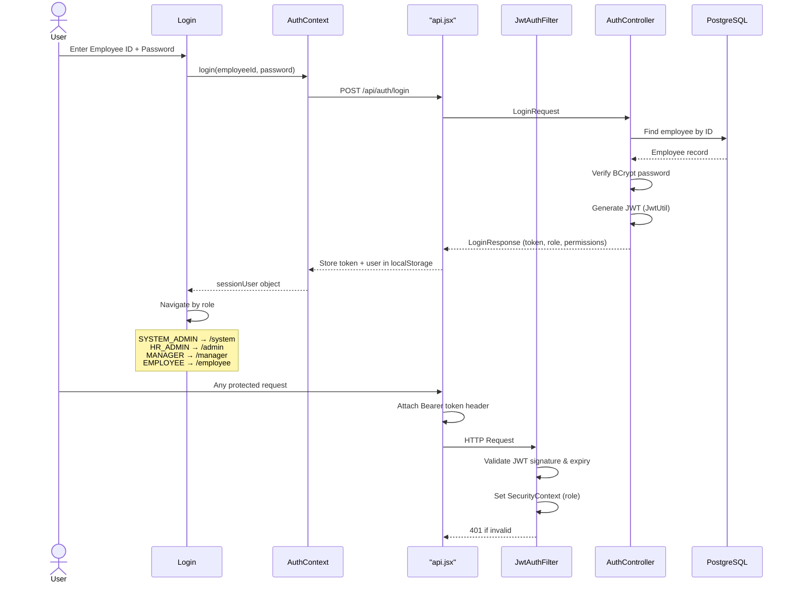
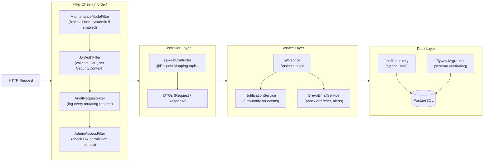
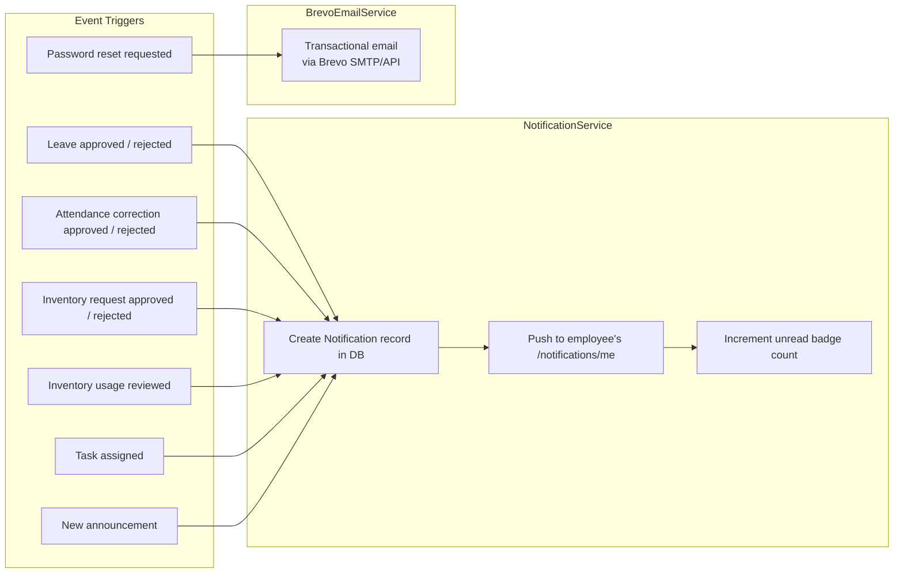

# D-HRM (Daloft People) — Application Architecture & Workflow Diagram

> Copy any Mermaid block below and paste it into [draw.io](https://app.diagrams.net/) using **Extras → Edit Diagram → Insert → From Mermaid**.

---

## 1. High-Level System Architecture

```mermaid
graph TB
    subgraph CLIENT["🖥️ Frontend — React + Vite"]
        UI["User Browser"]
        AUTH_CTX["AuthContext\n(JWT in localStorage)"]
        API_LYR["api.jsx\n(fetch wrapper + 15s GET cache)"]
        ROUTER["React Router\nBrowserRouter"]

        subgraph PAGES["Pages / Dashboards"]
            LOGIN["Login"]
            FP["Forgot Password"]
            RP["Reset Password"]
            ADMIN_DASH["AdminDashboard\n(HR_ADMIN)"]
            SYS_DASH["AdminDashboard\n(SYSTEM_ADMIN)"]
            MGR_DASH["ManagerDashboard\n(MANAGER)"]
            EMP_DASH["EmployeeDashboard\n(EMPLOYEE)"]
        end

        subgraph SHELL["WorkspaceShell (Layout)"]
            SIDEBAR["Collapsible Sidebar Nav"]
            TOPBAR["Top Bar + Notifications Bell"]
        end

        subgraph HR_MODULES["HR Admin Modules"]
            M_PEOPLE["EmployeeList"]
            M_ATTEND["AttendanceTable"]
            M_ANNOUNCE["Announcements"]
            M_TASKS["Tasks"]
            M_INVENTORY["Inventory"]
            M_LEAVE["LeaveManagement"]
            M_OFFICES["OfficeLocations"]
            M_DAMAGE["DamageReports"]
            M_REPORTS["Reports & Analytics"]
            M_HOLIDAYS["Holiday Calendar"]
            M_ANALYTICS["AnalyticsDashboard"]
        end

        subgraph SYS_MODULES["System Admin Modules (SystemAdminPanel)"]
            SM_CONTROL["Control Center"]
            SM_EMPLOYEES["HR Administrators"]
            SM_OFFICES["Offices & Geofences"]
            SM_ORG["Organization"]
            SM_SECURITY["Security Center"]
            SM_AUDIT["Audit Logs"]
            SM_SETTINGS["Configuration"]
            SM_HEALTH["System Health"]
        end

        subgraph EMP_MODULES["Employee Modules"]
            EM_HOME["Home (Attendance Clock)"]
            EM_LEAVE["Leave Management"]
            EM_INV["Employee Inventory"]
            EM_DAMAGE["Damage Reports"]
            EM_NOTIF["Notifications"]
            EM_PROFILE["Profile"]
        end

        subgraph MGR_MODULES["Manager Modules"]
            MM_TEAM["My Team"]
            MM_LEAVES["Leave Approvals"]
            MM_TASKS["Team Tasks"]
            MM_ATTEND["Team Attendance"]
            MM_CORRECTIONS["Attendance Corrections"]
        end
    end

    subgraph BACKEND["⚙️ Backend — Spring Boot 3.3 / Java 17"]
        subgraph FILTERS["Request Filters (Chain)"]
            F_MAINT["MaintenanceModeFilter"]
            F_JWT["JwtAuthFilter"]
            F_AUDIT["AuditRequestFilter"]
            F_ADMIN["AdminAccessFilter"]
        end

        subgraph CONTROLLERS["REST Controllers"]
            C_AUTH["AuthController\n/api/auth"]
            C_PROFILE["ProfileController\n/api/profile"]
            C_ATTEND["AttendanceController\n/api/attendance"]
            C_LEAVE["LeaveController\n/api/leaves"]
            C_TASK["TaskController\n/api/tasks"]
            C_NOTIF["NotificationController\n/api/notifications"]
            C_ANNOUNCE["AnnouncementController\n/api/announcements"]
            C_OFFICE["OfficeLocationController\n/api/admin/offices"]
            C_DAMAGE["DamageReportController\n/api/damage-reports"]
            C_INV["InventoryController\n/api/admin/inventory"]
            C_ORG["OrganizationController\n/api/system-admin/organization"]
            C_SYSADMIN_EMP["SystemAdminEmployeeController\n/api/system-admin/users"]
            C_SYSADMIN_SUM["SystemAdminSummaryController\n/api/system-admin/summary"]
            C_SYSADMIN_CTL["SystemAdminControlController\n/api/system-admin/settings"]
            C_REPORT["ReportController\n/api/admin/reports"]
        end

        subgraph SERVICES["Business Services"]
            S_AUTH["AuthService / PasswordResetService"]
            S_EMP["EmployeeService"]
            S_ATTEND["AttendanceService / AttendanceRegularizationService"]
            S_LEAVE["LeaveBalanceService"]
            S_TASK["TaskService"]
            S_NOTIF["NotificationService"]
            S_INV["InventoryService / EmployeeInventoryService"]
            S_ORG["OrganizationService"]
            S_ANNOUNCE["AnnouncementService"]
            S_AUDIT["AuditService"]
            S_EMAIL["BrevoEmailService"]
            S_SETTINGS["SystemSettingsService"]
            S_HOLIDAY["HolidayService"]
            S_ADMIN_ACCESS["AdminAccessService"]
        end

        subgraph REPOS["JPA Repositories (Spring Data)"]
            DB_EMPLOYEE["EmployeeRepository"]
            DB_ATTEND["AttendanceRepository\nAttendanceRegularizationRepository"]
            DB_LEAVE["LeaveRequestRepository\nLeaveBalanceRepository"]
            DB_TASK["TaskRepository"]
            DB_NOTIF["NotificationRepository"]
            DB_INV["ComponentRepository\nInventoryCategoryRepository\nInventoryRequestRepository\nInventoryUsageUpdateRepository\nStockTransactionRepository"]
            DB_ANNOUNCE["AnnouncementRepository"]
            DB_AUDIT["AuditLogRepository"]
            DB_OFFICE["OfficeLocationRepository"]
            DB_DAMAGE["DamageReportRepository"]
            DB_SETTINGS["SystemSettingRepository"]
            DB_HOLIDAY["OrganizationHolidayRepository"]
            DB_ADMIN["AdminAccessRepository"]
            DB_PWD["PasswordResetTokenRepository"]
        end

        DB[("🐘 PostgreSQL\n(Flyway Migrations)")]
    end

    subgraph EXTERNAL["☁️ External Services"]
        EMAIL["Brevo (Sendinblue)\nTransactional Email"]
    end

    UI --> ROUTER
    ROUTER --> AUTH_CTX
    ROUTER --> PAGES
    PAGES --> SHELL
    SHELL --> HR_MODULES
    SHELL --> SYS_MODULES
    SHELL --> EMP_MODULES
    SHELL --> MGR_MODULES
    PAGES --> API_LYR
    HR_MODULES --> API_LYR
    SYS_MODULES --> API_LYR
    EMP_MODULES --> API_LYR
    MGR_MODULES --> API_LYR

    API_LYR -->|"HTTPS + Bearer JWT"| FILTERS
    FILTERS --> CONTROLLERS
    CONTROLLERS --> SERVICES
    SERVICES --> REPOS
    REPOS --> DB
    S_EMAIL --> EMAIL
    S_ATTEND --> S_NOTIF
    S_LEAVE --> S_NOTIF
    S_TASK --> S_NOTIF
    S_INV --> S_NOTIF
    S_AUTH --> S_EMAIL
```

---

## 2. Authentication & Authorization Flow

---

## 3. Role-Based Access Control

```mermaid
graph LR
    subgraph ROLES["User Roles"]
        R1["SYSTEM_ADMIN\n(Org-level governance)"]
        R2["HR_ADMIN\n(Delegated HR ops)"]
        R3["MANAGER\n(Team-scoped)"]
        R4["EMPLOYEE\n(Self-service)"]
    end

    subgraph SYS_ACCESS["SYSTEM_ADMIN Access"]
        SA1["Manage HR Admins"]
        SA2["Define Org Structure\n(Departments, Managers)"]
        SA3["Grant/Revoke HR permissions"]
        SA4["System Settings & Maintenance Mode"]
        SA5["Security Center & Audit Logs"]
        SA6["Offices & Geofence Config"]
        SA7["System Health Dashboard"]
        SA8["Holiday Calendar"]
        SA9["Task Broadcast"]
    end

    subgraph HR_ACCESS["HR_ADMIN Access (delegated)"]
        HA1["People Management (PEOPLE)"]
        HA2["Attendance Review (ATTENDANCE)"]
        HA3["Announcements (COMMUNICATION)"]
        HA4["Task Management (TASKS)"]
        HA5["Inventory (INVENTORY)"]
        HA6["Leave Management (LEAVE)"]
        HA7["Office Locations (OFFICE)"]
        HA8["Damage Reports (PEOPLE)"]
        HA9["Reports & Analytics (REPORTS)"]
        HA10["Holiday Calendar (HOLIDAY_CALENDAR)"]
    end

    subgraph MGR_ACCESS["MANAGER Access"]
        MA1["View team roster"]
        MA2["Approve / Reject leave"]
        MA3["Approve / Reject attendance corrections"]
        MA4["View team attendance"]
        MA5["Create & manage team tasks"]
        MA6["My Workspace (Employee self-service)"]
    end

    subgraph EMP_ACCESS["EMPLOYEE Access"]
        EA1["Check in / Check out\n(with optional geofence)"]
        EA2["Work-from-Home clock"]
        EA3["Attendance regularization request"]
        EA4["Apply for leave"]
        EA5["View leave balances"]
        EA6["Request inventory items"]
        EA7["Submit usage updates"]
        EA8["File damage reports"]
        EA9["View notifications"]
        EA10["Update profile"]
    end

    R1 --> SYS_ACCESS
    R2 --> HR_ACCESS
    R3 --> MGR_ACCESS
    R4 --> EMP_ACCESS
    R3 --> R4
```

---

## 4. Core Business Workflows

```mermaid
flowchart TD
    subgraph ATTEND_FLOW["📅 Attendance Workflow"]
        A1([Employee opens dashboard]) --> A2{Geofence enabled?}
        A2 -->|Yes| A3[Get current GPS location]
        A2 -->|No| A4[Check-in without location]
        A3 --> A5{Within radius?}
        A5 -->|Yes| A6[POST /attendance/check-in with coords]
        A5 -->|No| A7[Error: Outside geofence]
        A4 --> A6
        A6 --> A8[Attendance record created]
        A8 --> A9[Employee checks out → POST /check-out]
        A9 --> A10[Work hours computed]
        A10 --> A11{Needs correction?}
        A11 -->|Yes| A12[Submit regularization request]
        A12 --> A13{Manager or HR reviews}
        A13 -->|Approve| A14[Record updated]
        A13 -->|Reject| A15[Request closed]
    end

    subgraph LEAVE_FLOW["🏖️ Leave Workflow"]
        L1([Employee applies for leave]) --> L2[POST /leaves\nwith type, dates, reason]
        L2 --> L3[Leave request created → PENDING]
        L3 --> L4{Reports to Manager?}
        L4 -->|Yes| L5[Manager reviews]
        L4 -->|No| L6[HR Admin reviews]
        L5 --> L7{Decision}
        L6 --> L7
        L7 -->|APPROVED| L8[Leave balance deducted\nNotification sent]
        L7 -->|REJECTED| L9[Employee notified with reason]
        L8 --> L10{Employee wants to cancel?}
        L10 -->|Yes| L11[PUT /leaves/:id/cancel]
    end

    subgraph INV_FLOW["📦 Inventory Workflow"]
        I1([Employee requests item]) --> I2[GET /inventory/available\nbrowse components]
        I2 --> I3[POST /inventory/requests]
        I3 --> I4[Request → PENDING]
        I4 --> I5[HR Admin reviews\nPOST /admin/inventory/requests/:id/review]
        I5 --> I6{Decision}
        I6 -->|APPROVED| I7[Item assigned to employee\nStock decremented]
        I6 -->|REJECTED| I8[Employee notified]
        I7 --> I9[Employee submits usage update\nPOST /inventory/usage]
        I9 --> I10[HR reviews usage\nPOST /admin/inventory/usage-updates/:id/review]
    end

    subgraph TASK_FLOW["✅ Task Workflow"]
        T1{Creator} -->|HR Admin| T2[POST /admin/tasks]
        T1 -->|Manager| T3[POST /manager/tasks]
        T1 -->|System Admin| T4[POST /system-admin/tasks]
        T2 --> T5[Task assigned to employee/dept/role]
        T3 --> T5
        T4 --> T5
        T5 --> T6[Employee: PATCH /tasks/:id/status]
        T6 --> T7{Status}
        T7 --> T8[TODO → IN_PROGRESS → COMPLETED]
    end
```

---

## 5. Backend Layer Architecture (per request)

---

## 6. Data Model (Entity Relationships)

```mermaid
erDiagram
    Employee {
        Long id PK
        String employeeId
        String name
        String email
        String passwordHash
        Role role
        Boolean active
        Long departmentId FK
        Long reportingManagerId FK
        String designation
        String phone
    }

    Department {
        Long id PK
        String name
        String code
    }

    Attendance {
        Long id PK
        Long employeeId FK
        LocalDate workDate
        LocalTime checkInTime
        LocalTime checkOutTime
        Double workingHours
        String status
    }

    AttendanceRegularizationRequest {
        Long id PK
        Long attendanceId FK
        Long employeeId FK
        LocalTime requestedCheckIn
        LocalTime requestedCheckOut
        String reason
        RequestStatus status
        Long reviewedById FK
    }

    LeaveRequest {
        Long id PK
        Long employeeId FK
        String leaveType
        LocalDate startDate
        LocalDate endDate
        String reason
        LeaveStatus status
        Long reviewedById FK
    }

    LeaveBalance {
        Long id PK
        Long employeeId FK
        String leaveType
        Integer year
        Integer totalDays
        Integer usedDays
    }

    Task {
        Long id PK
        String title
        String description
        String assignedTo
        String status
        Long createdById FK
    }

    Component {
        Long id PK
        String name
        Long categoryId FK
        Integer totalStock
        Integer availableStock
        String unit
    }

    InventoryCategory {
        Long id PK
        String name
    }

    InventoryRequest {
        Long id PK
        Long employeeId FK
        Long componentId FK
        Integer quantity
        RequestStatus status
        String purpose
    }

    InventoryUsageUpdate {
        Long id PK
        Long employeeId FK
        Long componentId FK
        Integer quantityUsed
        UsageStatus status
    }

    StockTransaction {
        Long id PK
        Long componentId FK
        TransactionType type
        Integer quantity
        Long performedById FK
    }

    Announcement {
        Long id PK
        String title
        String message
        Long createdById FK
        LocalDateTime createdAt
    }

    Notification {
        Long id PK
        Long employeeId FK
        String title
        String message
        Boolean read
        LocalDateTime createdAt
    }

    DamageReport {
        Long id PK
        Long employeeId FK
        String description
        String status
        LocalDateTime reportedAt
    }

    OfficeLocation {
        Long id PK
        String name
        Double latitude
        Double longitude
        Integer radiusMeters
        Boolean active
    }

    AuditLog {
        Long id PK
        Long actorId FK
        String method
        String path
        String action
        LocalDateTime timestamp
    }

    OrganizationHoliday {
        Long id PK
        String name
        LocalDate date
        Boolean active
        Integer year
    }

    SystemSetting {
        Long id PK
        String settingKey
        String settingValue
    }

    AdminAccess {
        Long id PK
        Long adminId FK
        String permissions
    }

    Employee ||--o{ Attendance : "has"
    Employee ||--o{ AttendanceRegularizationRequest : "submits"
    Employee ||--o{ LeaveRequest : "applies"
    Employee ||--o{ LeaveBalance : "holds"
    Employee ||--o{ Task : "assigned to"
    Employee ||--o{ InventoryRequest : "requests"
    Employee ||--o{ InventoryUsageUpdate : "reports"
    Employee ||--o{ Notification : "receives"
    Employee ||--o{ DamageReport : "files"
    Employee ||--o{ AuditLog : "generates"
    Employee }|--|| Department : "belongs to"
    Component }|--|| InventoryCategory : "categorized by"
    Component ||--o{ InventoryRequest : "requested via"
    Component ||--o{ StockTransaction : "tracked via"
    AdminAccess ||--|| Employee : "grants access to"
```

---

## 7. Frontend Routing Map

```mermaid
graph TD
    ROOT["/ (root)"] -->|redirect| DECIDE{User logged in?}
    DECIDE -->|No| LOGIN["/login"]
    DECIDE -->|SYSTEM_ADMIN| SYS["/system\nAdminDashboard (system mode)"]
    DECIDE -->|HR_ADMIN| ADMIN["/admin\nAdminDashboard (HR mode)"]
    DECIDE -->|MANAGER| MGR["/manager\nManagerDashboard"]
    DECIDE -->|EMPLOYEE| EMP["/employee\nEmployeeDashboard"]

    LOGIN --> FP["/forgot-password\nForgotPassword"]
    FP --> RP["/reset-password\nResetPassword"]

    ADMIN --> ADMIN_DEEP["/admin/:module"]
    ADMIN_DEEP --> MOD1["people"]
    ADMIN_DEEP --> MOD2["attendance"]
    ADMIN_DEEP --> MOD3["announcements"]
    ADMIN_DEEP --> MOD4["tasks"]
    ADMIN_DEEP --> MOD5["inventory"]
    ADMIN_DEEP --> MOD6["leave"]
    ADMIN_DEEP --> MOD7["offices"]
    ADMIN_DEEP --> MOD8["damage"]
    ADMIN_DEEP --> MOD9["reports"]
    ADMIN_DEEP --> MOD10["holidays"]

    SYS --> SYS_TABS["Tabs (in-page state)"]
    SYS_TABS --> ST1["system (Control Center)"]
    SYS_TABS --> ST2["employees (HR Admins)"]
    SYS_TABS --> ST3["offices (Offices & Geofences)"]
    SYS_TABS --> ST4["organization"]
    SYS_TABS --> ST5["security"]
    SYS_TABS --> ST6["audit"]
    SYS_TABS --> ST7["settings"]
    SYS_TABS --> ST8["holidays"]
    SYS_TABS --> ST9["health"]
    SYS_TABS --> ST10["tasks"]

    EMP --> EMP_TABS["Tabs (in-page state)"]
    EMP_TABS --> ET1["home (Attendance Clock)"]
    EMP_TABS --> ET2["leave"]
    EMP_TABS --> ET3["inventory"]
    EMP_TABS --> ET4["damage"]
    EMP_TABS --> ET5["notifications"]
    EMP_TABS --> ET6["profile"]

    MGR --> MGR_TABS["Tabs (in-page state)"]
    MGR_TABS --> MT1["team"]
    MGR_TABS --> MT2["leaves"]
    MGR_TABS --> MT3["tasks"]
    MGR_TABS --> MT4["attendance"]
    MGR_TABS --> MT5["corrections"]
```

---

## 8. Notification & Email Events

